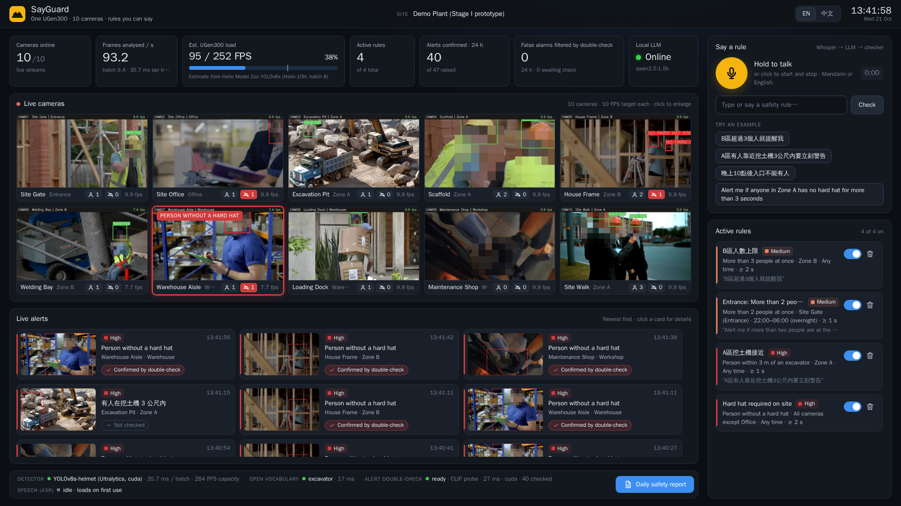
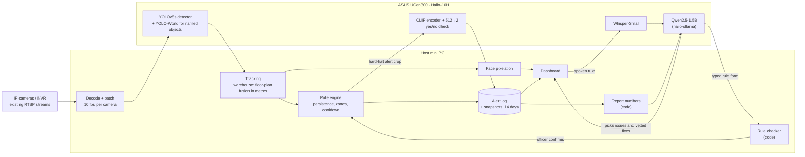

English | [繁體中文](README.zh-TW.md)

# SayGuard

**Every camera on site watched by one ASUS UGen300 — and safety rules you can simply say.**

ASUS UGen AI League · Battlefield Lightning · Workplace AI

**[▶ Watch the 3-minute demo video](https://youtu.be/SH1x9OGXXZQ)**

> **Stage I status:** the prototype runs end to end on a PC with an NVIDIA GPU. Both detectors are
> compiled to HEFs for the Hailo-10H, with their INT8 accuracy checked in Hailo's emulator; running
> on the UGen300 itself is the Stage II work.

Live dashboard, hard-hat mode. Captured on a cloud GPU machine with a slower CPU than our PC, so a few
streams show under 10 fps; the measured figures below are from the PC unless marked otherwise.

## The problem

Construction sites and warehouses already have cameras, but almost nobody watches them live.
A missing hard hat or a worker too close to a forklift is usually seen in the recording, after
something has happened. Smart cameras that do detect hazards come with a fixed list of rules:
a new zone or a new distance limit means another vendor project. And when alerts are noisy,
people stop reading them.

## What SayGuard does

- **Watches every camera at once.** One small box next to the video recorder analyses all
  streams. On a construction site it checks hard hats on every camera. In a warehouse it fuses
  all cameras into one live floor plan, so each worker is counted once and distances to
  forklifts are measured in metres.
- **Takes new rules by voice.** The safety officer says, in Mandarin or English, *"Warn me if
  anyone is within 3 m of a forklift"* or *"七號走道有人停留超過5秒就通知我"*. SayGuard turns the
  sentence into a rule, shows it for confirmation, and it is live seconds later. For objects,
  zones, distances, counts and times it already knows, there is no data to collect and nothing
  to retrain.
- **Raises alerts people can trust.** A violation must persist before it counts, and a fast
  yes/no model double-checks every hard-hat alert before it reaches the officer. In warehouse mode
  a worker seen by three cameras gets one alert, not three.
- **Writes the daily safety report.** The numbers come straight from the alert log; the
  language model picks the issues that matter most and a vetted fix for each.
- **Keeps video on site.** Every model runs locally and faces are pixelated in the dashboard and
  in saved snapshots.

Warehouse mode on the synthetic Warehouse 010 scene, captured on the same cloud machine (its CPU
keeps the streams near 6–7 fps here; about 10 fps on our PC).

## How it fits together

SayGuard works with the cameras a site already has. A mini PC reads their existing RTSP streams,
and a UGen300 connected to it over USB runs the neural networks. No camera or recorder is
replaced.

In the Stage I prototype the host's NVIDIA GPU runs the networks shown on the UGen300.

- **One detector for all cameras.** Frames from every stream are batched through a single
  YOLOv8s, so adding a camera adds load, not another model.
- **Warehouse mode puts cameras on a map.** Each camera is calibrated to the floor plan. A
  person's position is taken from where they stand, positions from all cameras are fused into
  one worker, and vehicles are placed where their wheels touch the ground. Zones are drawn
  once on the plan and rules are written in metres.
- **Decisions, not chat (inspired by Jev).** TypeSafe AI's Jev made the case that most of what
  software asks an AI is a decision, such as yes or no, a choice or a filled-in form, not prose.
  Jev is only available as a cloud API, so SayGuard rebuilds the idea from small models that Hailo
  supports on the UGen300. The alert double-check is a CLIP image encoder with a 512→2 decision head
  instead of a generative vision-language model: **18× faster** (15 ms vs 283 ms per alert) and
  more accurate (95.3 % vs 91.7 %).
- **The LLM proposes, code checks, the officer confirms.** Speech goes through Whisper; the
  small LLM drafts the rule as structured JSON; a deterministic checker corrects every number,
  time and object it finds in the sentence; the officer approves. For the report, code does all
  the counting and the LLM only chooses among issues that really happened and fixes we vetted.
  A 1.5-billion-parameter model is enough because it is never trusted on its own.
- **Built for the UGen300 from day one.** Every model has a Hailo-10H counterpart in the Hailo
  Model Zoo. Both detectors are already compiled to HEFs for Hailo-10H, with INT8 accuracy nearly
  matching float, and the LLM is called through the Ollama API, which hailo-ollama serves on the
  device.

| Model | Job | Hailo-10H build | Licence |
|---|---|---|---|
| YOLOv8s, fine-tuned (2 and 6 classes) | hard hats; warehouse people and vehicles | both compiled to HEFs; INT8 checked in Hailo's emulator | AGPL-3.0 |
| YOLO-World v2-S | objects a spoken rule names | Hailo Model Zoo | AGPL-3.0 |
| CLIP ViT-B/32 image encoder + 512→2 head | alert double-check | Hailo Model Zoo encoder; head retrained on INT8 features | MIT |
| Whisper-Small | speech to text | Hailo GenAI Model Zoo | MIT |
| Qwen2.5-1.5B-Instruct | rule form, report plan | Hailo GenAI Model Zoo (hailo-ollama) | Apache-2.0 |

## Results from the Stage I prototype

Measured on a PC GPU with the same networks that will run on the Hailo-10H; the spoken-rule test
ran on a cloud GPU. The last row comes from Hailo's INT8 emulator (run on a CPU and a cloud T4),
not from a UGen300.

| | |
|---|---|
| Hard-hat detector | **0.939 mAP50** on 2,001 images it never saw |
| Ten cameras, one detector | every frame analysed, **100 frames/s** (10 cameras × 10 fps); about 40 % of one UGen300 (estimate) |
| Rule sentence → exactly right rule (typed held-out sentences) | **95 %** (construction site) and **84–88 %** (warehouse), against 16–40 % for the LLM alone |
| The same sentences spoken (synthetic Taiwan Mandarin and US English voices, with site noise) | **90 %** (construction site) and **74–86 %** (warehouse) |
| Alert double-check (Jev-style yes/no model) | **95.3 %** correct on held-out crops in **15 ms**; a generative VLM: 91.7 % in 283 ms |
| Warehouse mode, six synthetic test warehouses the detector never trained on | head count off by **0.05–1.7 people** (summing cameras: up to 60); door and dock zones covered **100 %** of entries with **no false alerts**; forklift 3 m rule covered **92 %** of events (after two alert-logic fixes; the run frozen before them: 94 % and 89 %) |
| Daily report plan | actions aimed at the wrong problem: **20 % → 0 %** (blind AI judges) |
| Hailo-10H INT8 builds (Hailo's emulator, one evaluator for float and INT8) | hard-hat detector **0.889** vs 0.893 mAP50; warehouse detector **0.947** vs 0.947, and **0.951** at the cameras' 16:9 shape (544×960) |

The full numbers, how each was measured and the known limits are in
[docs/results](docs/results/README.md).

## Why it is feasible

- **Cheap hardware.** One UGen300 (NT$6,380 retail, 2.5 W) next to the existing recorder covers a
  site area of up to 12 cameras (our coverage spec; the warehouse-mode load on the chip is measured
  in Stage II); larger sites add a box per area.
- **A port, not a rebuild.** The networks were chosen because Hailo-10H builds already exist.
  Stage II moves the detectors, the yes/no check, Whisper and Qwen2.5 onto the UGen300; the host
  keeps decoding and the dashboard.
- **A clear business model.** One box per site area, sold and installed through
  CCTV installers to contractors, factories and warehouses that already own cameras.

## What it cannot do yet

- In two of the six test warehouses the detector missed most forklifts; a short fine-tune on a
  customer's own vehicles is planned.
- A worker's ID can change within tens of seconds, so the dashboard counts and alerts without
  showing IDs.
- Large halls with distant cameras need more cameras or another box per area.
- Alerts appear on the dashboard with a snapshot; phone and site-alarm outputs are not built yet.
- Spoken rules are measured with synthetic voices, not real officers; Whisper still mishears some
  Mandarin words (「B區」 as 「比區」), which the officer catches when confirming the rule.

## Stage II plan (Nov 6 – Dec 4)

1. Run both detector HEFs on the UGen300 through HailoRT and measure FPS and latency over USB at
   batch 1 and 8, including the 12-camera warehouse load at 960×960 and 544×960.
2. Move the yes/no check, Whisper and Qwen2.5 (hailo-ollama) onto the device.
3. Test at the ASUS test space: calibrate a multi-camera floor plan, tune thresholds, measure
   alert latency and power.
4. Deliver the finals package: code, benchmarks, demo video, deck.

## In this repository

| | |
|---|---|
| [docs/SITE_MODE.md](docs/SITE_MODE.md) | how warehouse mode works |
| [docs/results](docs/results/README.md) | every measurement and its limits |
| [docs/HAILO_PORT.md](docs/HAILO_PORT.md) | the Hailo-10H port: compiler flow and status |
| [docs/SETUP.md](docs/SETUP.md) | run the prototype and reproduce the numbers |

Licence: [GNU AGPL-3.0](LICENSE). Data and model licences: [docs/LICENSES.md](docs/LICENSES.md).
Hard-hat training data: Roboflow Universe Hard Hats v2 (CC BY 4.0). Warehouse scenes: NVIDIA
PhysicalAI-SmartSpaces (CC BY 4.0). Construction-site demo footage: Mixkit free clips, not
redistributed; the dashboard screenshots show frames of them under the Mixkit licence.
