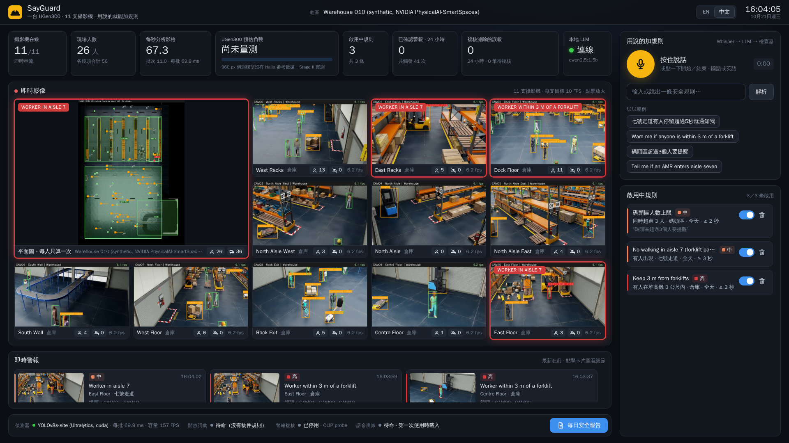

[English](README.md) | 繁體中文

# SayGuard

**一台 ASUS UGen300 顧好現場每一支攝影機，安全規則用說的就能加。**

ASUS UGen AI League・Battlefield Lightning・Workplace AI


## 要解決的問題

工地和倉庫幾乎都裝了攝影機，但很少有人真的即時盯著畫面看。有人沒戴安全帽、有人離堆高機太近，通常都是出事後翻錄影才發現。市面上的 AI 攝影機雖然能偵測，規則卻是出廠就寫死的，想多加一個管制區、改一個安全距離，就得再找廠商開專案。誤報一多，現場的人很快就不再理會警報。

## SayGuard 做什麼

- **同時顧好每一支攝影機**：在錄影主機旁放一台小盒子，所有畫面一起分析。工地模式檢查每支鏡頭裡的人有沒有戴安全帽；倉庫模式把所有鏡頭整合成一張即時平面圖，每個人只算一次，跟堆高機的距離直接用公尺計算。
- **規則用講的就能加**：工安人員用國語或英文說一句「七號走道有人停留超過5秒就通知我」或「Warn me if anyone is within 3 m of a forklift」，SayGuard 就把它變成一條規則，確認後幾秒內生效。不用收集資料，也不用重新訓練模型。
- **警報值得信任**：違規要持續一段時間才算數；安全帽警報發出前，還會讓第二個模型再確認一次。倉庫模式裡，同一個人就算三支鏡頭都拍到，也只發一則警報。
- **自動寫工安日報**：數字全部直接從警報紀錄統計，語言模型負責挑出最該處理的問題，並替每一項配上事先審過的改善措施。
- **影像不出現場**：所有模型都在現場執行，儀表板和存檔的快照都會把人臉打上馬賽克。



## 系統怎麼整合

SayGuard 直接沿用現場原有的攝影機：一台迷你電腦讀取現有的 RTSP 串流，UGen300 用 USB 接在這台電腦上，負責跑所有神經網路。不用換掉任何攝影機或錄影主機。

```
 IP 攝影機 / NVR ──►  主機（迷你電腦）                       ◄──►  ASUS UGen300（Hailo-10H）
  現有的 RTSP 串流      解碼・追蹤・平面圖整合                        偵測模型（YOLOv8s）
                        規則引擎・警報紀錄・儀表板                     CLIP 是非判斷複核
                                      │                              Whisper（語音辨識）
                                      ▼                              Qwen2.5-1.5B（規則、日報）
                        工安人員：即時儀表板、警報、日報、用說的加規則
```

- **一個模型看全部鏡頭**：所有串流的畫面打包成一批，送進同一個 YOLOv8s。多接一支攝影機只是多一點運算量，不用多一個模型。
- **倉庫模式把鏡頭放上地圖**：每支攝影機都對平面圖校正過。人的位置以雙腳踩的地方為準，不同鏡頭拍到的同一個人會合併成一位工人；車輛則以輪子著地的位置定位。管制區在平面圖上畫一次就好，規則直接用公尺來寫。
- **LLM 起草、程式把關、人員確認**：語音先經 Whisper 轉成文字，小型語言模型把句子整理成結構化的規則，規則檢查器再核對句子裡講到的數字、時間和物件，有錯就改正，最後由工安人員按下確認。日報也一樣：統計全部交給程式，LLM 只能從實際發生過的問題和我們事先審過的改善措施裡挑選。正因為它從不單獨做決定，15 億參數的小模型就夠用。
- **一開始就照 UGen300 設計**：用到的每個模型，在 Hailo Model Zoo 都有對應的 Hailo-10H 版本。安全帽偵測模型已經編譯成 Hailo-10H 格式；LLM 走 Ollama 介面，UGen300 上的 hailo-ollama 提供的正是同一套介面。

## Stage I 原型的成果

以下數據在 PC 的 GPU 上測得，使用的模型和 Hailo-10H 上要跑的相同。

| | |
|---|---|
| 安全帽偵測 | 在 2,001 張沒看過的圖片上 **mAP50 0.939** |
| 十支攝影機共用一個模型 | 每秒分析約 **105 張**畫面，約佔一台 UGen300 的 40%（估計值） |
| 一句話變成完全正確的規則 | 工地 **95%**、倉庫 **84–88%**；只靠 LLM 只有 16–40% |
| 警報複核 | 在沒參與訓練的測試圖片上 **95.3%** 判斷正確，每則 15 毫秒 |
| 倉庫模式：偵測模型沒訓練過的六棟合成測試倉庫 | 人數誤差只有 **0.05–1.7 人**（各鏡頭直接相加最多差 60 人）；門口與碼頭區的進入事件 **100%** 涵蓋、**零誤報**；堆高機 3 公尺規則涵蓋 **92%** 的事件 |
| 日報的改善措施 | 措施配錯問題的比例 **20% → 0%**（AI 盲評） |
| Hailo-10H INT8 版本 | mAP50 **0.889**，浮點版 0.893（Hailo 模擬器） |

完整數據、量測方式和目前已知的限制，請見 [docs/results](docs/results/README.zh-TW.md)。

## 為什麼可行

- **硬體便宜**：一台 UGen300（台灣售價 NT$6,380、功耗 2.5 W）放在現有錄影主機旁，就能顧好最多 12 支攝影機的區域；場地更大就每區加一台。
- **是移植，不是重做**：當初選模型，就是因為它們都已經有 Hailo-10H 版本。Stage II 會把偵測模型、複核模型、Whisper 和 Qwen2.5 搬到 UGen300 上，主機只負責解碼和儀表板。
- **商業模式清楚**：每個區域一台盒子，每個工地另收訂閱費；由監視器安裝商賣給已經裝好攝影機的營造廠、工廠和倉庫。

## 目前還做不到的事

- 六棟測試倉庫裡有兩棟，偵測模型漏掉了大部分的堆高機。之後打算用客戶自己的車輛畫面再微調。
- 同一位工人的編號可能幾十秒就換一次，所以儀表板只計數、發警報，不顯示個人編號。
- 很大、鏡頭又離得遠的廠房，需要多裝攝影機，或每區多放一台。

## Stage II 計畫（11/6 – 12/4）

1. 在 UGen300 上編譯並執行兩個偵測模型，實測 USB 連線下的處理量。
2. 把複核模型、Whisper 和 Qwen2.5（hailo-ollama）移到裝置上。
3. 到 ASUS 的測試場地實測：校正多鏡頭平面圖、調整門檻、量測警報延遲和功耗。
4. 完成決賽交件：程式碼、效能數據、示範影片和簡報。

## 文件導覽

| | |
|---|---|
| [docs/SITE_MODE.zh-TW.md](docs/SITE_MODE.zh-TW.md) | 倉庫模式怎麼運作 |
| [docs/results](docs/results/README.zh-TW.md) | 所有量測結果與限制 |
| [docs/HAILO_PORT.zh-TW.md](docs/HAILO_PORT.zh-TW.md) | 移植到 Hailo-10H：編譯流程與進度 |
| [docs/SETUP.zh-TW.md](docs/SETUP.zh-TW.md) | 執行原型、重現數據 |

授權：[GNU AGPL-3.0](LICENSE)。資料與模型的授權見 [docs/LICENSES.zh-TW.md](docs/LICENSES.zh-TW.md)。倉庫場景來自 NVIDIA PhysicalAI-SmartSpaces（CC BY 4.0）；工地示範影片取自 Mixkit 免費素材，repo 中不附檔。
