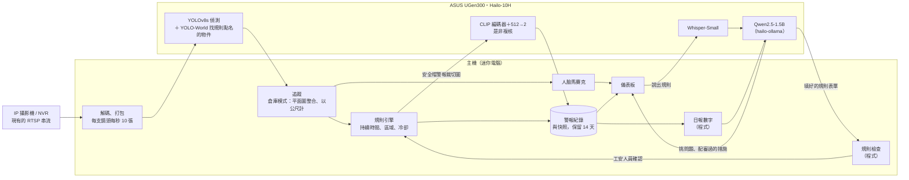

[English](README.md) | 繁體中文

# SayGuard

**一台 ASUS UGen300 顧好現場每一支攝影機，安全規則用說的就能加。**

ASUS UGen AI League・Battlefield Lightning・Workplace AI

**[▶ 觀看 3 分鐘示範影片](https://youtu.be/SH1x9OGXXZQ)**

> **Stage I 進度**：原型目前在裝有 NVIDIA 顯示卡的 PC 上完整運作。兩個偵測模型都已編譯成 Hailo-10H 的 HEF，INT8 準確率也在 Hailo 模擬器上驗證過；真正搬到 UGen300 上執行，是 Stage II 的工作。

工地模式的即時儀表板。這張是在雲端 GPU 機器上拍的，它的 CPU 比我們的 PC 慢，所以有幾路不到 10 fps；下方的量測數字除非另有註明，都是在 PC 上量的。

## 要解決的問題

工地和倉庫幾乎都裝了攝影機，但很少有人真的即時盯著畫面看。有人沒戴安全帽、有人離堆高機太近，通常都是出事後翻錄影才發現。市面上的 AI 攝影機雖然能偵測，規則卻是出廠就寫死的，想多加一個管制區、改一個安全距離，就得再找廠商開專案。誤報一多，現場的人很快就不再理會警報。

## SayGuard 做什麼

- **同時顧好每一支攝影機**：在錄影主機旁放一台小盒子，所有畫面一起分析。工地模式檢查每支鏡頭裡的人有沒有戴安全帽；倉庫模式把所有鏡頭整合成一張即時平面圖，每個人只算一次，跟堆高機的距離直接用公尺計算。
- **規則用講的就能加**：工安人員用國語或英文說一句「七號走道有人停留超過5秒就通知我」或「Warn me if anyone is within 3 m of a forklift」，SayGuard 就把它變成一條規則，確認後幾秒內生效。只要是系統已經認得的物件、區域、距離、人數和時間，就不必收集資料，也不必重新訓練。
- **警報值得信任**：違規要持續一段時間才算數；安全帽警報送到工安人員面前之前，還會由一個專門回答「是或否」的快速模型再確認一次。倉庫模式裡，同一個人就算三支鏡頭都拍到，也只發一則警報。
- **自動寫工安日報**：數字全部直接從警報紀錄統計，語言模型負責挑出最該處理的問題，並替每一項配上事先審過的改善措施。
- **影像不出現場**：所有模型都在現場執行，儀表板和存檔的快照都會把人臉打上馬賽克。

倉庫模式，合成場景 Warehouse 010，同一台雲端機器拍攝（受 CPU 限制約每秒 6–7 張；在我們的 PC 上約 10 張）。

## 系統怎麼整合

SayGuard 直接沿用現場原有的攝影機：一台迷你電腦讀取現有的 RTSP 串流，UGen300 用 USB 接在這台電腦上，負責跑所有神經網路。不用換掉任何攝影機或錄影主機。

Stage I 原型裡，圖中 UGen300 那一側的模型暫時由主機的 NVIDIA 顯示卡執行。

- **一個模型看全部鏡頭**：所有串流的畫面打包成一批，送進同一個 YOLOv8s。多接一支攝影機只是多一點運算量，不用多一個模型。
- **倉庫模式把鏡頭放上地圖**：每支攝影機都對平面圖校正過。人的位置以雙腳踩的地方為準，不同鏡頭拍到的同一個人會合併成一位工人；車輛則以輪子著地的位置定位。管制區在平面圖上畫一次就好，規則直接用公尺來寫。
- **只做判斷、不聊天（參考 Jev 的做法）**：TypeSafe AI 推出的 Jev 有個觀點：軟體要 AI 做的事，多半不是寫一段文章，而是下一個判斷，像是回答是或否、從選項裡挑一個、把表格填好。Jev 只能透過雲端 API 使用，所以我們改用 Hailo 已經支援、可以放上 UGen300 的小模型，做出同樣性質的系統。警報複核不用生成式的視覺語言模型，而是 CLIP 影像編碼器加上一個 512→2 的判斷層：**快 18 倍**（每則 15 毫秒，生成式模型要 283 毫秒），準確率還更高（95.3% 對 91.7%）。
- **LLM 起草、程式把關、人員確認**：語音先經 Whisper 轉成文字，小型語言模型把句子整理成結構化的規則，規則檢查器再核對句子裡講到的數字、時間和物件，有錯就改正，最後由工安人員按下確認。日報也一樣：統計全部交給程式，LLM 只能從實際發生過的問題和我們事先審過的改善措施裡挑選。正因為它從不單獨做決定，15 億參數的小模型就夠用。
- **一開始就照 UGen300 設計**：用到的每個模型，在 Hailo Model Zoo 都有對應的 Hailo-10H 版本。兩個偵測模型都已編譯成 Hailo-10H 的 HEF，INT8 準確率和浮點版幾乎一樣；LLM 走 Ollama 介面，UGen300 上的 hailo-ollama 提供的正是同一套介面。

| 模型 | 用途 | Hailo-10H 版本 | 授權 |
|---|---|---|---|
| YOLOv8s，自行微調（2 類、6 類） | 安全帽；倉庫裡的人和車輛 | 兩個都已編譯成 HEF；INT8 已在 Hailo 模擬器驗證 | AGPL-3.0 |
| YOLO-World v2-S | 規則裡點名的其他物件 | Hailo Model Zoo | AGPL-3.0 |
| CLIP ViT-B/32 影像編碼器＋512→2 判斷層 | 警報複核 | Model Zoo 的編碼器；判斷層用 INT8 特徵重新訓練 | MIT |
| Whisper-Small | 語音轉文字 | Hailo GenAI Model Zoo | MIT |
| Qwen2.5-1.5B-Instruct | 填規則表單、日報規劃 | Hailo GenAI Model Zoo（hailo-ollama） | Apache-2.0 |

## Stage I 原型的成果

以下數據在 PC 的 GPU 上測得，使用的模型和 Hailo-10H 上要跑的相同；語音輸入那一列是在雲端 GPU 上測的。最後一列來自 Hailo 的 INT8 模擬器（在 CPU 和雲端 T4 上執行），還沒在 UGen300 實機上跑過。

| | |
|---|---|
| 安全帽偵測 | 在 2,001 張沒看過的圖片上 **mAP50 0.939** |
| 十支攝影機共用一個模型 | 10 支攝影機、每支每秒 10 張，**每秒 100 張**全部分析；約佔一台 UGen300 的 40%（估計值） |
| 一句話變成完全正確的規則（打字輸入的保留測試句） | 工地 **95%**、倉庫 **84–88%**；只靠 LLM 只有 16–40% |
| 同一批句子改用講的（合成的台灣國語和美式英文語音，加工地噪音） | 工地 **90%**、倉庫 **74–86%** |
| 警報複核（Jev 式是非判斷模型） | 在沒參與訓練的測試圖片上 **95.3%** 判斷正確，每則 **15 毫秒**；生成式 VLM 只有 91.7%，每則要 283 毫秒 |
| 倉庫模式：偵測模型沒訓練過的六棟合成測試倉庫 | 人數誤差只有 **0.05–1.7 人**（各鏡頭直接相加最多差 60 人）；門口與碼頭區的進入事件 **100%** 涵蓋、**零誤報**；堆高機 3 公尺規則涵蓋 **92%** 的事件（修正兩處警報邏輯之後；修正前凍結的那一輪是 94% 和 89%） |
| 日報的改善措施 | 措施配錯問題的比例 **20% → 0%**（AI 盲評） |
| Hailo-10H INT8 版本（Hailo 模擬器，浮點和 INT8 用同一套評分） | 安全帽偵測 **0.889**，浮點 0.893；倉庫偵測 **0.947**（浮點也是 0.947），改成攝影機的 16:9 比例（544×960）則是 **0.951** |

完整數據、量測方式和目前已知的限制，請見 [docs/results](docs/results/README.zh-TW.md)。

## 為什麼可行

- **硬體便宜**：一台 UGen300（台灣售價 NT$6,380、功耗 2.5 W）放在現有錄影主機旁，就能顧好最多 12 支攝影機的區域（這是我們訂的涵蓋規格；倉庫模式在晶片上的負載，Stage II 實測）；場地更大就每區加一台。
- **是移植，不是重做**：當初選模型，就是因為它們都已經有 Hailo-10H 版本。Stage II 會把偵測模型、複核模型、Whisper 和 Qwen2.5 搬到 UGen300 上，主機只負責解碼和儀表板。
- **商業模式清楚**：每個區域一台盒子，由監視器安裝商賣給、裝給已經有攝影機的營造廠、工廠和倉庫。

## 目前還做不到的事

- 六棟測試倉庫裡有兩棟，偵測模型漏掉了大部分的堆高機。之後打算用客戶自己的車輛畫面再微調。
- 同一位工人的編號可能幾十秒就換一次，所以儀表板只計數、發警報，不顯示個人編號。
- 很大、鏡頭又離得遠的廠房，需要多裝攝影機，或每區多放一台。
- 警報目前顯示在儀表板上並附快照；推播到手機、接現場警報器的功能還沒做。
- 語音規則是用合成語音測的，不是真人工安人員；Whisper 還會聽錯一些國語詞（「B區」聽成「比區」），工安人員確認規則時會看到。

## Stage II 計畫（11/6 – 12/4）

1. 用 HailoRT 在 UGen300 上執行兩個偵測模型的 HEF，實測 USB 連線下 batch 1 和 batch 8 的 FPS 與延遲；倉庫模式則在 960×960 和 544×960 兩種尺寸下，實測 12 支攝影機同時跑的負載。
2. 把複核模型、Whisper 和 Qwen2.5（hailo-ollama）移到裝置上。
3. 到 ASUS 的測試場地實測：校正多鏡頭平面圖、調整門檻、量測警報延遲和功耗。
4. 完成決賽交件：程式碼、效能數據、示範影片和簡報。

## 文件導覽

| | |
|---|---|
| [docs/SITE_MODE.zh-TW.md](docs/SITE_MODE.zh-TW.md) | 倉庫模式怎麼運作 |
| [docs/results](docs/results/README.zh-TW.md) | 所有量測結果與限制 |
| [docs/HAILO_PORT.zh-TW.md](docs/HAILO_PORT.zh-TW.md) | 移植到 Hailo-10H：編譯流程與進度 |
| [docs/SETUP.zh-TW.md](docs/SETUP.zh-TW.md) | 執行原型、重現數據 |

授權：[GNU AGPL-3.0](LICENSE)。資料與模型的授權見 [docs/LICENSES.zh-TW.md](docs/LICENSES.zh-TW.md)。安全帽訓練資料來自 Roboflow Universe Hard Hats v2（CC BY 4.0）；倉庫場景來自 NVIDIA PhysicalAI-SmartSpaces（CC BY 4.0）；工地示範影片取自 Mixkit 免費素材，repo 中不附檔，儀表板截圖裡的畫面依 Mixkit 授權使用。
