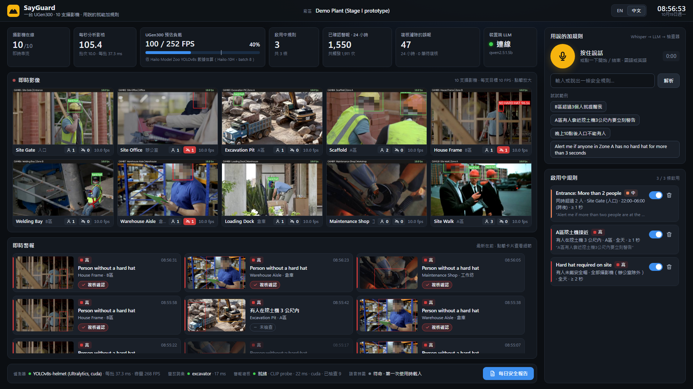

[English](README.md) | 繁體中文

# SayGuard

**每個廠區一台 ASUS UGen300 · 每支攝影機都納入監看 · 安全規則用說的就好。**

SayGuard 是我們參加 ASUS UGen AI League 的作品（Battlefield Lightning · Workplace AI）。
它看著現場原有的攝影機，再加上在要監看的區域被少於兩支攝影機看到的地方補一支攝影機；安全主管
用說的就能新增規則，例如「有人離堆高機 3 公尺內就警告我」。關於已知物件、區域、距離、人數和時間
的新規則，一句話就能建立，不需要蒐集資料，也不需要重新訓練。新的物件類別仍可能需要訓練：
開放詞彙偵測可以用，但它的準確度沒有量測。Stage II 會把這一切移到放在現場錄影主機旁的一台
UGen300（Hailo-10H）上。

它有兩種模式：

- **工地模式（安全帽）**，用於營建工地（`configs/site.yaml`）。涵蓋十支彼此獨立的攝影機，
  每支都檢查安全帽，每則安全帽警報都會用第二個模型再確認一次（是非判斷複核）。
- **倉庫模式**（`configs/warehouse.yaml`）。把多支已校正的攝影機融合到同一張平面圖上：
  每位作業人員只算一次，而不是每支攝影機各算一次。區域和與堆高機的距離都以公尺計，作業人員每次
  進入只發一則警報，而不是每支攝影機各發一則。

本 repo 是 **Stage I 原型**。整條流程在本地的 PC GPU（RTX 5060 Ti）上執行，還沒有任何東西在
UGen300 上跑過。每項工作都對應到一個 Hailo-10H 模型，所以 Stage II 會把流程移到 UGen300 上
（見 [docs/HAILO_PORT.zh-TW.md](docs/HAILO_PORT.zh-TW.md)）。目前只有安全帽偵測器編譯成了 HEF，
而且還沒在硬體上執行過。本頁所有量測數字都來自 [docs/FACTS.md](docs/FACTS.md)。大多數取自
[docs/results/](docs/results/README.zh-TW.md) 裡的原始結果檔；少數來自執行中的原型、沒有結果檔的
觀察值，標為**即時觀察**。還沒量測的項目，我們會直接寫明。



## 兩種模式

### 工地模式（安全帽）

- **十路影像，一個偵測器。** 所有攝影機的影格合成一個批次，送進一個 YOLOv8s 安全帽偵測器，
  它在 Roboflow Hard Hats v2（CC BY 4.0）上微調過。每支攝影機用一個不分類別的小型追蹤器
  追蹤頭部，作用中的規則每支攝影機每秒檢查十次。示範用 10 段循環播放的影片當作串流。
- **規則提到的物件。** 規則提到的物件（「梯子」、「挖土機」）由 YOLO-World 只憑那個詞去找，
  不必重新訓練。與它的距離則由作業人員頭部的大小來估算。這個模式下的開放詞彙偵測和頭部大小
  估距都沒有量測過。在倉庫示範場景上，YOLO-World 在 30 個堆高機框中找到 0 個，所以新的物件
  類別仍可能需要訓練過的偵測器。
- **更少誤報。** 條件必須持續（預設 2 秒）才會發出警報。接著由是非判斷複核看那張裁切圖：
  凍結的 CLIP ViT-B/32 影像編碼器，加上一個線性 512→2 輸出層（「這個人有戴安全帽嗎？」）。
  這是一個判斷，不是一段對話，所以不需要生成式模型。VLM 仍可作為選項
  （`verifier.backend: vlm`），比較結果見 `docs/results/vlm_check.json`。

### 倉庫模式（已校正攝影機融合到同一張平面圖）

- **示範影片。** 示範使用 NVIDIA PhysicalAI-SmartSpaces `Warehouse_010`（合成資料，
  CC BY 4.0）的 11 支同步、已校正攝影機，以影格鎖定的方式播放。
- **每位作業人員只算一次，而不是每支攝影機各算一次。** 每支攝影機的人物框會換成地面上的一個點：
  腳下的點，或腳被畫面切掉時改用頭部正下方的點。每個點都帶有它在那支攝影機視角下的不確定度。
  `sayguard/sitetrack.py` 把各攝影機的點融合成同一位作業人員。
- **區域和距離以公尺計。** 區域只在平面圖上畫一次。車輛的位置取自它的框與地面接觸的地方
  （兩個下角和中點），所以與堆高機的距離是地面距離。
- **每位作業人員每次進入一則警報，而不是每支攝影機各一則。** 所有看得到該作業人員的攝影機都會
  標出這則警報。安全主管用區域名稱說規則（「七號走道」、「aisle seven」、「碼頭區」）。
- **為現場訓練的偵測器。** YOLOv8s，6 個類別：人、堆高機、托板車、搬運車、移動機器人、
  人形機器人。它在 5 棟合成建築、8 個場景的 8,000 張影格上微調，從未用任何評估場景訓練。
  機器人有自己的類別，所以被偵測成機器人的機器人不會被算成作業人員。現成模型在這些場景上不能用：
  在 Warehouse_010 上，YOLO-World 在 30 個堆高機框中找到 0 個；COCO YOLOv8s 只把其中 7 個
  認成「truck」，還把 39 % 的人形機器人當成人。（這是記在 `scripts/prepare_site_dataset.py`
  裡的一次性檢查，不是結果檔。）
- **設定只在驗證場景（Warehouse_020）上選定**（`docs/results/w020_settings_analysis.json`）。
  - 攝影機以信心值 ≥ 0.7 看到某位作業人員時才顯示他，信心值維持 ≥ 0.6 就持續顯示。
  - 車輛需要信心值 ≥ 0.6。
  - 堆高機距離加 0.1 m 的緩衝。
- **警報邏輯**（`sayguard/rules/engine.py`）。前兩點就是那兩項警報邏輯修正。它們是在看過測試場景
  的凍結版執行之後，在非測試場景（Warehouse_009、012、017、020）上開發的。
  - 新的 id 只有在以下情況才算是剛被警報過的那位作業人員（因此不發第二則警報）：他的 id 還在
    追蹤中時，新 id 就落在他身上；或他的 id 消失後，新 id 在 10 秒內出現在他被警報的位置附近，
    或在 3 秒內出現在他最後被看到的位置附近（交接）。其他人，例如同一條走道上的下一位作業人員，
    會收到自己的警報。
  - 人員進入規則在作業人員離開區域超過 10 秒後再進入時，會再次警報。
  - 有人一直停留時，冷卻時間會拉開提醒的間隔。
- **畫面上不顯示作業人員 id。** id 在幾十秒內就會變動：在 5 分鐘的 Warehouse_010 片段中，
  平均每人 10.72 個 id（IDF1 0.516）。這個模式不提供安全帽規則，因為倉庫偵測器看的是整個人，
  沒有安全帽類別。

兩種模式共通：

- **每日安全報告。** 數字由程式計算，行動建議由本地 LLM 規劃（見下文）。
- **隱私。** 所有資料都留在現場。在儀表板畫面方塊和存下的快照中，只要偵測到頭部（工地模式）
  或人物（倉庫模式），臉部就會打馬賽克。漏掉臉的頻率沒有量測。

## 本地 LLM 怎麼用

SayGuard 在現場執行一個小型 LLM：Qwen2.5-1.5B-Instruct，透過 Ollama API 提供服務（目前在 PC 上
用 Ollama；Stage II 在 UGen300 上用 hailo-ollama）。它有兩項工作：

1. **規則。** 把一句口說的話變成規則，中文或英文都可以，並使用現場自己的攝影機和區域名稱。
2. **報告規劃。** 挑出每日報告要優先列出的問題，並為每個問題選一個審核過的改善做法。

1.5B 的模型文字寫得流暢，但事實不可靠，所以兩項工作都遵守同一個原則：

> **LLM 提出建議，程式負責檢查，每條規則都由安全主管最後確認。**

- JSON schema 限制模型能回傳的內容。
- 程式把它的回答拿去和輸入實際說的內容、或能計算出來的結果比對。
- 安全主管確認之前，任何規則都不會生效。報告規劃沒有人確認，但它只能從清單上的問題和審核過的
  做法中選擇。
- LLM 離線時，由確定性的處理路徑接手。規則方面，只用規則擷取器可以答對 90 % 的工地模式保留
  測試句，以及 68 % 的全新倉庫測試集。報告方面，改用範本建議。
- LLM 從不決定警報要不要發出（那是偵測器和規則引擎的事），從不把數字寫進報告，也從不
  自行啟用規則。

**在哪裡量測的。** 本頁所有 LLM 準確度都是在 PC GPU 上用 Ollama `qwen2.5:1.5b` 量測的。
Qwen2.5-1.5B 的 Hailo GenAI 版本採用不同的量化方式，還沒有量測。Hailo GenAI Model Zoo 在
Hailo-10H 上的參考數值是每秒 7.35 個 token、第一個 token 需 0.37 秒。據此我們估計（未量測），
在 UGen300 上（Stage II），一句口說規則變成規則 JSON 約需 11.3 秒，Whisper 轉寫一句 5 秒的規則
約需 2.4 秒（`docs/results/benchmark.md`）。

### 工作一：把一句話變成規則

1. Whisper-Small 把中文或英文語音轉成文字。現場的區域和攝影機名稱會作為 decoder prompt 傳給它。
2. Qwen2.5 填寫規則 schema（類型、攝影機、區域、物件、門檻、時段、持續時間、嚴重程度）。
   它會拿到現場自己的攝影機和區域清單。
3. **規則擷取器**（`sayguard/rules/parser.py`）是確定性的程式，讀出句子明確說出的內容：數字、
   距離、時間、物件名稱、規則類型關鍵字，以及區域和攝影機名稱。**檢查器**使用它：規則擷取器有
   找到某個欄位、而 LLM 的答案不同時，以擷取器為準。擷取器沒找到的欄位（例如因為說法不常見），
   就保留 LLM 的值。所以檢查器改寫的是它在句子中找到的數字、時間和物件，也可能漏掉某些說法。
   捏造的欄位會被刪除：句子沒提到的時段，或規則類型用不到的門檻或物件。警報文字會依最終
   欄位重新產生。
4. 儀表板顯示草稿，每一處被改寫的地方都附上備註。安全主管確認之後規則才會生效。

兩個來自執行中伺服器的**即時觀察**例子（沒有結果檔）：

- 「Alert me if more than two people are at the site gate after 10 pm」：LLM 提出的時段是
  22:00–00:00，檢查器套用既定慣例，改為 22:00–06:00。
- 「A區有人靠近挖土機三公尺內要立刻警告」：LLM 提出的物件是「excavation pit」（開挖坑），
  檢查器改用「excavator」（挖土機）。

在 PC 上，用 LLM + 檢查器解析一句規則，在保留測試集上平均需 0.35–0.40 秒（最長 0.64 秒）。

| 保留測試集（打字輸入的句子，中文 + 英文） | 句數 | 只用 LLM | 只用規則擷取器 | **LLM + 檢查器（實際採用）** | 延遲，平均／最大 |
|---|---|---|---|---|---|
| 工地模式（逐支攝影機的規則） | 20 | 40 % | 90 % | **95 %** | 347 / 469 ms |
| 倉庫模式（平面圖規則），第 1 組，第一次執行（在修正它揭露的問題之前） | 25 | 16 % | 80 % | **84 %** | — |
| 倉庫模式（平面圖規則），第 2 組，全新（從未用於調整） | 25 | 24 % | 68 % | **88 %** | 395 / 638 ms |

測試方式：

- 測試句是打字輸入的文字，所以這些分數不含語音辨識。語音辨識在錄音上的準確度沒有量測。
- 一句話必須每個標註欄位都正確才算對。
- 倉庫句子（`tests/site_rule_sentences.json`）由 AI 代理撰寫和標註：一位撰寫者和一位審查者，
  兩者都沒看過解析器程式碼。第 2 組出自另一組新的撰寫者和審查者。
- 84 % 是第 1 組的第一次執行，也是它唯一的盲測結果。之後解析器針對那次揭露的說法做了修正。
  修正後再量一次，第 1 組得分 100 %，但它已經不能算是測試。
- 開發集是用來建立擷取器的，所以分數不算測試：工地模式（32 句）25 % / 100 % / 96.9 %，
  倉庫模式（15 句）20 % / 100 % / 100 %。

單靠任何一半都不夠。在全新的倉庫測試集上，只用規則擷取器是 68 %，只用 LLM 是 24 %，兩者合起來
是 88 %。

**中文、英文和現場自己的名稱（屬於這項工作）。** 安全主管說中文或英文，用一般人的方式稱呼地點：
「七號走道」、「aisle seven」，或把碼頭區叫成「碼頭」。

- LLM 會拿到現場的攝影機清單，以及中英文兩種區域名稱。
- 規則擷取器比對區域名稱時，數字寫成阿拉伯數字、中文數字或英文單字都可以，結尾的「區」可有可無。
- 模型用簡體字回答時，會轉成台灣繁體（OpenCC）。報告也會把大陸用語換掉（攝像頭 → 攝影機）。

語言處理是在上面的規則分數裡一起量測的，因為每個測試集都混合中文和英文句子。它本身沒有單獨評分。

### 工作二：規劃每日報告

- 程式從警報紀錄算出每個數字、每張表和摘要。
- LLM 只看到當天實際發生的（攝影機、問題）組合，依次數由多到少排列，外加每類問題三個
  審核過的改善做法。
- 它挑出最重要的 3 個問題，每個配一個做法。它以 JSON schema 回傳問題編號和做法編號，
  schema 的 enum 只允許清單上的問題和做法 0–2。所以它不可能點名沒出問題的攝影機、張冠李戴，
  或捏造數字。
- 報告產生之前沒有人確認這份規劃，所以它只能選清單上的問題和審核過的做法。
- LLM 離線或回答不符合 schema 時，改用範本建議。

在 20 個合成日上的結果（`scripts/eval_report.py`，Qwen2.5-1.5B，在 PC 上透過 Ollama）。每則建議
由 2 位盲評 AI 評審評分：兩個獨立的評審代理，是 AI 模型，不是真人。評審不知道建議是哪種方法寫的，
並拿到每支攝影機當天真正的問題。在「問題不對」這一項上，177 則建議中有 176 則兩位評審意見一致。
評審過的執行結果是 `docs/results/report_actions_judged.json`；評審的 prompt、盲評批次和每一則
判定都在 `docs/results/report_actions_judging/`。

| 三則建議的產生方式 | 建議數 | 問題不對（兩位評審都認定） | 合理（兩位評審都認定） | 關鍵字檢查：張冠李戴 |
|---|---|---|---|---|
| LLM 自由撰寫建議（早期的 prompt） | 60 | 20.0 % | 45.0 % | 13.3 % |
| LLM 挑問題並撰寫建議，程式檢查（`actions="free"`） | 57 | 3.5 % | 52.6 % | 0.0 % |
| **LLM 挑問題並選一個審核過的做法（`actions="menu"`，預設）** | 60 | **0.0 %** | **100.0 %** | 0.0 % |

- 選單那一列，每個做法的文字都是我們事先寫好並審核過的。所以那裡的「合理」評的是 LLM 對問題和
  做法的選擇，不是它的文筆，這一欄和上面兩列不是同一件事的比較。
- `actions="free"` 那一列的 57 則建議中，有 14 則是取代 LLM 文字的範本文字。LLM 自己寫的 43 則，
  兩位評審都認定問題不對的佔 4.7 %，都認定合理的佔 37.2 %。

## 成果（Stage I，PC 原型）

| | 結果 | `docs/results/` 中的原始檔 |
|---|---|---|
| 安全帽偵測器，保留測試集（2,001 張影像） | mAP50 **0.9393**（Ultralytics val，分數 ≥ 0.001），precision 0.9132，recall 0.8986 | `detector_metrics.json` |
| 工地模式，十支攝影機、目標每秒 10 張，一個批次偵測器 | **即時觀察：** 約每秒分析 105 張影格，每批 10 張 31–40 ms。以名目上每秒 100 張計，估計佔一台 UGen300 的 40 %（依 Hailo 的 YOLOv8s 參考數值，batch 8 時 252 FPS；未量測） | 即時執行沒有結果檔；估計見 `benchmark.md` |
| 規則解析，工地模式，20 句打字輸入的保留測試句 | 只用 LLM 40 % → **LLM + 檢查器 95 %**（只用規則擷取器 90 %），平均 347 ms | `rule_parsing.json` |
| 規則解析，倉庫模式，2 × 25 句打字輸入的保留測試句 | 第 1 組第一次執行：只用 LLM 16 % → **LLM + 檢查器 84 %**；全新的第 2 組：只用 LLM 24 % → **LLM + 檢查器 88 %**（只用規則擷取器 80 % / 68 %） | `rule_parsing_site.json`、`rule_parsing_site_v1_first_run.json` |
| 每日報告建議，20 個合成日，每則 2 位盲評 AI 評審 | 問題不對 20.0 %（LLM 自由撰寫）→ **0.0 %**（LLM 挑問題 + 審核過的做法）；合理 45.0 % → 100.0 %（審核過的做法文字是我們寫的，所以評審評的是選擇） | `report_actions_judged.json` |
| 警報是非判斷複核（CLIP ViT-B/32 + 線性輸出層），193 張保留裁切圖 | **95.3 %** 正確。94 張有戴安全帽的裁切圖中放行 95.7 %（資料集標註的裁切圖，作為錯誤「沒戴安全帽」標記的替代指標），99 張未戴安全帽的裁切圖（違規）中保留 94.9 %；每張裁切圖平均 15.2 ms | `probe_train.json` |
| 安全帽偵測器編譯成 Hailo-10H 的 HEF（還沒在硬體上執行） | 在 Hailo 的位元精確模擬器上，INT8 mAP50 **0.889**，浮點為 0.8927；mAP50-95 0.56 對 0.5662。這和上面的 0.9393 是不同的評估方式（分數 ≥ 0.2 的 NMS、pycocotools），所以 0.889 只能和 0.8927 比較 | `hailo_int8.json` |
| CLIP 編碼器量化成 Hailo-10H 的 INT8（Hailo 位元精確模擬器，未編譯） | 用 INT8 特徵重新訓練輸出層後為 **95.3 %**，違規保留 93.9 %（PC 上為 94.9 %）；沿用 PC 的輸出層為 94.3 % | `clip_probe_int8.json` |
| 倉庫模式，偵測器從未訓練過的六棟測試建築的人數計算 | 融合後每張影格平均誤差 **0.05–1.74** 人；把各攝影機人數直接相加則是 1.76–60.09 人 | `site_eval*.json` |
| 倉庫模式，同樣六棟測試建築的警報，兩項警報邏輯修正之後 | 門口／碼頭區域：53 件事件全部涵蓋，其中 52 件有自己的警報（98 %），52 則警報中 0 則誤報。堆高機 3 m 規則：61 件涵蓋 56 件，其中 25 件有自己的警報（41 %），26 則中 1 則誤報。有涵蓋 = 有自己的警報，或落在同一個人先前警報的冷卻時間內（見下文）。修正前的凍結版執行：分別涵蓋 53 件中的 50 件、61 件中的 54 件，誤報分別為 26 則中 0 則、24 則中 1 則 | `site_eval*.json`、`site_by_zone_kind.json`、`frozen/` |

### 倉庫模式在偵測器從未訓練過的六棟測試建築上

**場景角色。**

- **測試：** Warehouse_010、013、015、018、019、022。偵測器從未在這些場景上訓練，而且它們和
  訓練場景是不同的建築。有兩點保留：
  - Warehouse_010 是示範場景。追蹤器是一邊看著它一邊開發的，它的區域來自示範設定檔
    （`configs/warehouse.yaml`），不是盲畫的。
  - 用來開發警報邏輯的 Warehouse_017，是測試場景 Warehouse_018 的雙胞胎（同一棟建築、同一組攝影機）。
- **驗證：** Warehouse_012 和 020。上面的信心值和距離設定是在 Warehouse_020 上選定的；它就是
  訓練場景（000–007）所在的建築，只是換成其他攝影機。
- **只用於開發：** Warehouse_009 和 017。有些 SmartSpaces 場景是同攝影機雙胞胎（同一棟建築、
  同一組攝影機）：009 是訓練場景 008 的雙胞胎，017 是測試場景 018 的雙胞胎。建築是依平面圖
  區分的：訓練場景 000–007 和驗證場景 020 位在同一棟建築，沒有任何測試場景和訓練場景共用
  平面圖。

**量測方式。**

- 其他五個測試場景（Warehouse_013、015、018、019、022；`configs/eval/*.yaml`）的區域，由沒看過
  任何結果的 AI 代理畫在攝影機涵蓋範圍圖上。同樣這些代理也替每個區域指定種類（門口／碼頭、
  通道、作業區或其他）。Warehouse_010 沿用示範設定檔的區域，種類由我們指定。每個區域的種類都列在
  `docs/results/site_by_zone_kind.json`。
- `scripts/eval_site.py` 執行與線上伺服器相同的融合和規則程式碼，並用 NVIDIA 的 ground truth
  評分。Ground truth 從不進入流程。
- 一件事件算**有涵蓋**的條件是：作業人員因這件事件收到自己的警報，或事件落在同一個人、同一條
  規則先前警報的冷卻時間內。依設計，這種情況下冷卻時間會擋掉第二則警報。**嚴格召回率**只計算
  有自己警報的事件。

| 測試場景 | 攝影機 | 有攝影機看得到的人數（真實平均） | 倉庫模式計數（平均誤差） | 各攝影機人數相加（平均誤差） |
|---|---|---|---|---|
| Warehouse_010 | 11 | 24.97 | 26.56 (1.74) | 51.64 (26.67) |
| Warehouse_013 | 10 | 15.83 | 15.49 (0.55) | 39.99 (24.16) |
| Warehouse_015 | 10 | 22.0 | 22.91 (1.05) | 82.09 (60.09) |
| Warehouse_018 | 3 | 1.0 | 1.05 (0.05) | 2.76 (1.76) |
| Warehouse_019 | 3 | 2.07 | 1.78 (0.34) | 4.5 (2.45) |
| Warehouse_022 | 4 | 9.8 | 8.48 (1.35) | 13.51 (3.86) |

| 規則種類，六個測試場景合計 | 有涵蓋 | 嚴格召回率（自己的警報） | 誤報 | 凍結版：有涵蓋 | 凍結版：嚴格召回率 | 凍結版：誤報 |
|---|---|---|---|---|---|---|
| 門口／碼頭區域 | 53 件中 53 件（100 %） | 53 件中 52 件（98 %） | 52 則中 0 則 | 53 件中 50 件（94 %） | 53 件中 26 件（49 %） | 26 則中 0 則 |
| 堆高機 3 m | 61 件中 56 件（92 %） | 61 件中 25 件（41 %） | 26 則中 1 則 | 61 件中 54 件（89 %） | 61 件中 23 件（38 %） | 24 則中 1 則 |
| 狹窄通道／走道 | 118 件中 98 件（83 %） | 118 件中 71 件（60 %） | 77 則中 3 則（4 %） | 118 件中 76 件（64 %） | 118 件中 39 件（33 %） | 40 則中 1 則 |
| 作業區 | 338 件中 323 件（96 %） | 338 件中 237 件（70 %） | 362 則中 26 則（7 %） | 338 件中 281 件（83 %） | 338 件中 147 件（43 %） | 244 則中 16 則 |
| 其他區域 | 48 件中 43 件（90 %） | 48 件中 34 件（71 %） | 44 則中 6 則（14 %） | 48 件中 34 件（71 %） | 48 件中 21 件（44 %） | 30 則中 4 則 |

主要數字來自最終版執行，也就是兩項警報邏輯修正（重新出現／交接，以及重新進入）之後的結果。
這兩項修正是在看過測試場景的**凍結版執行**（`docs/results/frozen/`）之後，在非測試場景
（Warehouse_009、012、017、020）上開發的。凍結版執行使用相同的偵測器和信心值設定，是比較乾淨的
保留測試結果。修正提高了涵蓋率，誤報也跟著增加：作業區從 244 則中 16 則變成 362 則中 26 則，
通道從 40 則中 1 則變成 77 則中 3 則，其他區域從 30 則中 4 則變成 44 則中 6 則。兩次執行的結果都有
公開。

堆高機規則的嚴格召回率（41 %）偏低是刻意的設計。它的 60 秒冷卻時間故意不對在停著的堆高機 3 公尺
內進進出出的作業人員重複警報，所以這些重複事件算有涵蓋，但沒有自己的警報。

在 Warehouse_010（示範場景）上，位置的 recall 為 0.928、precision 為 0.873，平均位置誤差 0.209 m。
作業人員到堆高機距離的誤差中位數為 0.2 m（MAE 0.28 m）。

**限制。**

- **驗證場景 Warehouse_020。** 它有 16 支攝影機，超出 12 支的規格，人數也最多（平均 49.02 人）。
  在那裡，堆高機規則涵蓋了 95 件事件中的 0.568（嚴格召回率 0.337），51 則警報中有 16 則誤報，
  人員 recall 為 0.519。那裡身高 20–40 px 的人只有 68 % 偵測得到，40–80 px 則有 92 %，下方規格中的
  40 px 就是由此而來。
- **堆高機偵測依場景而異。** 在 Warehouse_010（示範場景）上，有堆高機的影格中 0.986 偵測得到；
  在 Warehouse_018 只有 0.169，Warehouse_019 只有 0.115，Warehouse_022 為 0.793。偵測器在那些
  場景漏掉堆高機的原因還沒有確定。
- **作業人員 id 不穩定。** id 在幾十秒內就會變動：Warehouse_010 在 5 分鐘內平均每人 10.72 個 id，
  Warehouse_020 為 22.32 個。各測試場景的 IDF1 為 0.287–0.977，所以畫面上不顯示 id。
- **所有倉庫場景都是合成資料。** 還沒有量測過真實倉庫的影片。
- **倉庫偵測器還沒有 Hailo HEF。**

**由此得出的部署規格：** 每個不超過 12 支攝影機的區域配一台 UGen300，每個要監看的區域都要有
≥ 2 支攝影機以 ≥ 40 px 看到。12 支攝影機的上限是從測試場景得出的涵蓋範圍規格。一台 UGen300 能否
負擔倉庫模式的運算量（960 px 的倉庫偵測器）沒有量測，排在 Stage II 第 1 週。儀表板在倉庫模式下的
「Est. UGen300 load」讀數用的是 640 px 的安全帽偵測器參考值，所以會低估負載。

完整方法、各場景數字和限制請見 [docs/SITE_MODE.zh-TW.md](docs/SITE_MODE.zh-TW.md) 和
[docs/results/](docs/results/README.zh-TW.md)。

**尚未量測（Stage II）：**

- 所有在 UGen300 本身上的項目，包括 HEF 經 USB 的吞吐量和延遲、hailo-ollama 上的 GenAI 延遲、
  裝置功耗，以及端到端的警報延遲。
- 倉庫模式在 UGen300 上的運算負載（960 px 的倉庫偵測器）。
- 用 Qwen2.5-1.5B 的 Hailo GenAI 版本做規則解析和報告建議的準確度。上面所有 LLM 數字都來自
  PC 上的 Ollama。
- 語音辨識在錄音上的準確度。規則解析測試集是打字輸入的。
- 工地模式下的開放詞彙偵測準確度和頭部大小估距誤差。
- 臉部馬賽克漏掉臉的頻率。

單元測試：264 項通過（`python -m pytest`）。

## 執行原型（Windows 11、NVIDIA GPU）

大型檔案（資料集、權重、影片、警報資料庫）放在 repo 外的工作目錄：`SAYGUARD_WORK`，預設為
`D:/ugen-work`。設定檔中以 `@work/` 開頭的路徑會解析到那裡。另外需要 `PATH` 上有 `ffmpeg` 和
`ffprobe`，以及 [Ollama](https://ollama.com)。

```powershell
python -m venv venv
venv\Scripts\activate
pip install torch torchvision --index-url https://download.pytorch.org/whl/cu128
pip install -r requirements.txt
ollama serve                                   # in its own terminal (Stage II: hailo-ollama on the UGen300)
ollama pull qwen2.5:1.5b
```

工作目錄下需要的模型檔：

- `models/hf/whisper-small`
- `models/yolov8s-worldv2.pt`
- `models/clip/ViT-B-32.pt`，YOLO-World 和是非判斷複核共用
- 選用：`models/hf/Qwen2-VL-2B-Instruct`，給 VLM 複核用

### 工地模式（安全帽）

```powershell
python scripts/prepare_dataset.py              # Hard Hats v2 -> YOLO format
python scripts/train_detector.py --epochs 40   # -> @work/models/helmet_yolov8s.pt (+ .onnx for the Hailo DFC)
python scripts/train_probe.py                  # yes/no head -> @work/models/helmet_probe.npz
python scripts/fetch_videos.py list            # 10 Mixkit pages: download each clip by hand (docs/VIDEO_SOURCES.md)
python scripts/fetch_videos.py check           # all saved? -> writes the camera selection
python scripts/make_streams.py                 # transcode the 10 looping demo streams
python -m sayguard serve                       # configs/site.yaml -> http://127.0.0.1:8000 (?lang=en or ?lang=zh)
```

`start_demo.cmd` 一步啟動 Ollama 和工地模式示範，裡面的路徑是依作者的電腦設定的。

### 倉庫模式

```powershell
# 1. Demo scene: calibration, floor plan, ground truth (only evaluation needs it; --no-gt skips it), 11 videos
python scripts/fetch_smartspaces.py train/Warehouse_010
python scripts/make_site_streams.py train/Warehouse_010    # frame-locked 10 fps streams + streams.json

# 2. Site detector (weights are not distributed). Training scenes only:
#    prepare_site_dataset.py refuses Warehouse_010, _018 and _020.
python scripts/fetch_smartspaces.py train/Warehouse_000    # likewise 002, 004, 006, 008, 011, 014, 016
python scripts/prepare_site_dataset.py --name site_v3 --train train/Warehouse_000 train/Warehouse_002 train/Warehouse_004 train/Warehouse_006 train/Warehouse_008 train/Warehouse_011 train/Warehouse_014 "train/Warehouse_016:~9,10" --val "train/Warehouse_016:9,10"
python scripts/train_detector.py --data "@work/datasets/site_v3/data.yaml" --name site_v8s_v3 --out site_yolov8s.pt --imgsz 960 --batch 16 --epochs 20

# 3. Run
python -m sayguard serve --config configs/warehouse.yaml   # http://127.0.0.1:8000
```

串流準備好之後，`start_demo_warehouse.cmd` 以同樣方式啟動倉庫模式，裡面的路徑同樣是依作者的
電腦設定的。

資料集有 8,000 張訓練影像，來自 5 棟合成建築中的 8 個 SmartSpaces 訓練場景（Warehouse_000/002/
004/006 是同一棟建築）。量測所用的權重（`@work/models/site_yolov8s.pt`）分兩階段訓練。第一階段從
COCO YOLOv8s 開始，在 Warehouse_000/004/008/014 上訓練 30 個 epoch，以 016 作驗證。上面最後一行
指令再從那個 checkpoint 接著訓練（以 `--model` 指定）。照原樣執行的話，這行指令會從 COCO YOLOv8s
開始。

儀表板的攝影機清單和「用說的加規則」面板裡的範例規則，都取自設定檔（`configs/warehouse.yaml` 的
`cameras:` 和 `examples:`）。

## 重現數字

```powershell
python scripts/eval_detector.py              # hard-hat detector, test split -> detector_metrics.json
python scripts/benchmark.py                  # throughput tables -> benchmark.md
python scripts/eval_rules.py                 # rule parsing, hard-hat mode (typed sentences) -> rule_parsing.json (needs Ollama)
python scripts/eval_rules.py --site          # rule parsing, warehouse mode (typed sentences) -> rule_parsing_site.json
python scripts/eval_report.py                # report actions, 20 synthetic days -> report_actions.json (needs Ollama)
python scripts/train_probe.py                # yes/no head -> probe_train.json
python scripts/eval_vlm.py --per-class 100   # generative VLM on the same crops -> vlm_check.json
python scripts/eval_yesno.py                 # yes/no methods on 193 held-out crops -> yesno_check.json (earlier comparison table)

pip install motmetrics                       # needed by eval_site.py, not in requirements.txt
python scripts/eval_site.py --all-zones                                              # Warehouse_010 -> site_eval.json
python scripts/eval_site.py --config configs/eval/warehouse_018.yaml --all-zones     # -> site_eval_warehouse_018.json
```

這些腳本的說明：

- **結果寫到哪裡。** 結果會寫到 `docs/results/` 和 `@work/results/`。
- **倉庫場景。** 每個 `configs/eval/warehouse_0XX.yaml` 的開頭都列出該場景的三道指令：下載、
  製作串流、評估。Warehouse_020 和 _022 在資料集的 `val/` 分割中，其他都在 `train/`。
- **`eval_site.py` 的選項。**
  - `--dets-cache dets.pkl` 第一次執行時存下偵測器輸出，之後直接重播，所以之後的執行不需要 GPU。
  - `--tag NAME` 把實驗結果只寫到 `@work/results/`，不動已公開的檔案。
- **重跑也無法重現的項目。**
  - 倉庫句子第 1 組的第一次執行（`rule_parsing_site_v1_first_run.json`）：解析器之後已針對
    這些句子修正。
  - 凍結版的倉庫執行：它早於那兩項警報邏輯修正。
  - 盲評 AI 評審的分數：評審步驟沒有寫成腳本。評審過的執行結果保留為
    `report_actions_judged.json`，prompt、批次和判定在 `report_actions_judging/`。重跑
    `eval_report.py` 會改寫 `report_actions.json`，裡面不會有這些分數。
- **Hailo 建置和模擬器檢查**在 `hailo/`。見 [docs/HAILO_PORT.zh-TW.md](docs/HAILO_PORT.zh-TW.md)。

## 目錄結構

```
sayguard/            pipeline, rule engine + parser, detectors (Ultralytics / HailoRT), tracking,
                     privacy, alert store, alert verifier (CLIP probe / VLM), ASR, report, server
  site.py            warehouse mode: camera calibration, floor plan, zones
  sitetrack.py       warehouse mode: cross-camera fusion of workers, vehicles from ground contacts
  site_pipeline.py   warehouse mode: the live loop (shared with scripts/eval_site.py)
  site_view.py       warehouse mode: camera tiles and the live floor plan
web/                 dashboard (vanilla JS, works offline)
scripts/             dataset prep, training, evaluation, clip selection, SmartSpaces download and streams, benchmark
hailo/               Hailo Dataflow Compiler flow: ONNX -> INT8 -> HEF, emulator accuracy checks
configs/site.yaml    hard-hat mode: ten cameras, zones, models, default rules
configs/warehouse.yaml  warehouse mode: 11 calibrated cameras of Warehouse_010, floor zones, example rules
configs/eval/        one config per evaluation scene except Warehouse_010 (zones drawn on coverage maps by AI agents blind to results)
docs/                FACTS.md (every published number), SITE_MODE.md (warehouse mode end to end),
                     results/, Hailo port plan, licences, video sources, demo script, pitch outline
tests/               unit tests (rules, parser, site rules, cross-camera tracking, tracker, events,
                     report, verifier, ASR decode, synced sources) and the warehouse rule sentences
start_demo.cmd       Windows launcher for the hard-hat demo
start_demo_warehouse.cmd  Windows launcher for the warehouse demo
```

## 授權

SayGuard 以 [GNU AGPL-3.0](LICENSE) 釋出，因為它建立在 AGPL-3.0 的 Ultralytics 之上。資料、
模型和相依套件列在 [docs/LICENSES.zh-TW.md](docs/LICENSES.zh-TW.md)。

- **工地模式的影片：** 免費的 Mixkit 片段，手動下載，不再散布
  （[docs/VIDEO_SOURCES.zh-TW.md](docs/VIDEO_SOURCES.zh-TW.md)）。
- **倉庫場景：** 「NVIDIA PhysicalAI-SmartSpaces (MTMC_Tracking_2026), CC BY 4.0」，由
  `scripts/fetch_smartspaces.py` 下載，從不提交進 repo。
- **模型：** Qwen2.5-1.5B-Instruct 為 Apache-2.0，Whisper-Small 和 CLIP 為 MIT。
