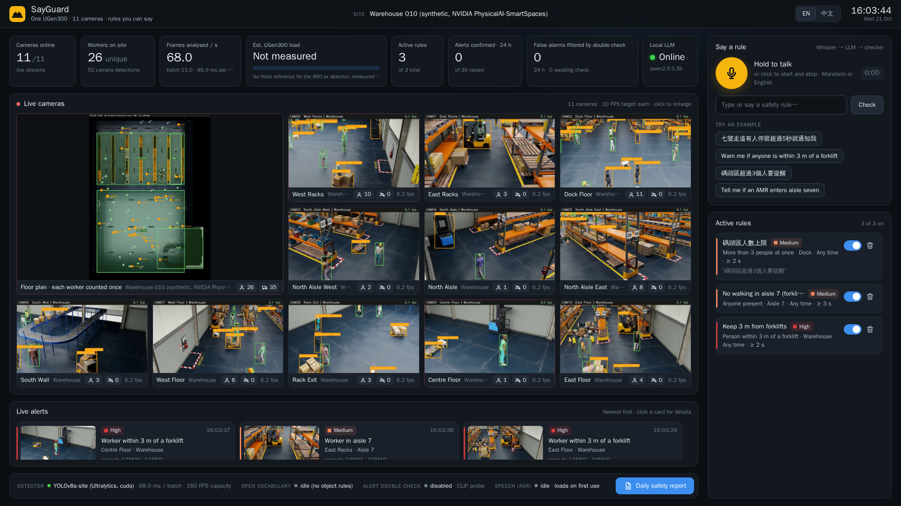

English | [繁體中文](SITE_MODE.zh-TW.md)

# How warehouse mode works

**All the cameras of one warehouse area become a single live floor plan: each worker counted
once, distances in metres, one alert per worker.**



## The idea

On a construction site, checking hard hats camera by camera works. In a warehouse it does not.
Cameras overlap, so the same worker often appears in three or four of them at once: a per-camera
system counts that worker three or four times and sends three or four alerts. A zone such as
"aisle 7" has to be drawn again in every camera that sees it. And "within 3 m of a forklift" is
hard to judge from one flat image.

Warehouse mode treats the cameras of one area as sensors for one place. Every camera is
calibrated to the floor plan, so every person and vehicle it sees becomes a point on the floor,
in metres. From there, counting people, checking zones and measuring distances are simple
geometry, and rules apply to people rather than to camera views.

## From cameras to floor plan to alerts

```
 up to 12 camera streams
        │   one batched detector: people, forklifts, pallet trucks, transporters, robots
        ▼
 boxes in every camera
        │   calibration: image pixels → floor metres
        ▼
 points on the floor plan ──► workers: one per person, fused across cameras
                          └─► vehicles: where they touch the floor
        │
        ▼
 zones and rules in metres ──► one alert per worker per entry ──► dashboard · alert log · daily report
```

- **One detector for every camera.** Frames from all streams go through one batched YOLOv8s
  that finds people and vehicles. Off-the-shelf models failed here: on the demo warehouse,
  YOLO-World found 0 of 30 labelled forklifts, and a standard COCO model took 39 % of the
  humanoid robots for people. So we fine-tuned our own six-class detector on 8,000 images from
  eight training scenes, none of which is used for evaluation. Robots have their own classes and
  are never counted as workers.
- **Calibration.** Each camera is calibrated to the floor plan once. After that, any point on the
  floor in its image maps to a position in metres. The demo uses the calibration that NVIDIA
  ships with the dataset.
- **Where a person stands.** A person's position is where their feet touch the floor. When a
  shelf, a cart or the edge of the frame hides the feet, the bottom of the box is not the feet,
  so SayGuard also projects the head and knows the person stands somewhere between the two
  points. Small, distant people are less certain, so they count for less.
- **Cameras fused into one worker.** Views from different cameras that land on the same spot are
  one worker. The position is a weighted median of the views, so one bad view cannot drag a
  worker metres away. A worker who walks behind a rack keeps their identity for a few seconds; a
  flickering false detection must persist before it becomes a worker. No faces and no appearance
  model are involved: identity is pure geometry.
- **Vehicles from ground contacts.** The points where a vehicle meets the floor are projected
  onto the plan, and the distance to a worker is the distance to the nearest contact any camera
  saw. Rules only need to know whether a forklift is within 3 m of this worker right now, so
  vehicles need no identity.
- **Zones and rules in metres.** Zones are drawn once on the floor plan, not once per camera. A
  rule can watch for anyone in a zone, more than N people in a zone, a worker within N metres of
  a vehicle, or a vehicle in a zone. Rules are still spoken: *"七號走道有人停留超過5秒就通知我"* or
  *"Tell me if an AMR enters aisle seven"* becomes a rule card to confirm. The card lists the
  cameras that cover the zone, and a rule that no camera can see cannot be switched on.
- **One alert per worker per entry.** A condition must last (2 s for the forklift rule) before
  it counts. It then raises one alert for that worker, however many cameras see them, and a
  cooldown spaces reminders while they stay. Walking back into a zone after some time outside
  is a new entry and alerts again. Tracking IDs can change within tens of seconds, so before
  alerting, the engine checks whether a "new" worker is the one it has just alerted. The next
  person down the same aisle still gets their own alert.

The same code runs live on the dashboard and in the evaluation below, where it is scored against
ground truth.

## What the safety officer sees

- **A live floor plan.** It sits among the camera tiles and shows the zones, the cameras, every
  worker as a dot (red during an alert) and the vehicles. An active proximity alert draws a red
  line labelled with the distance in metres.
- **One honest head count.** "Workers on site" counts each person once. Next to it is what the
  cameras would report if their counts were added up, so the difference is plain to see.
- **The same worker, marked everywhere.** A worker in an alert is outlined in red in every camera
  that sees them. The alert card carries a snapshot, the rule, the zone and the list of cameras.
- **Rules in plain words.** The "Say a rule" panel takes Mandarin or English, spoken or typed.
- **No worker numbers, no faces.** The dashboard counts and alerts without showing tracking IDs.
  Faces are pixelated in every tile and snapshot, and video never leaves the site.
- **The daily safety report** works as in hard-hat mode, from the same alert log.

## Measured results

Six synthetic test warehouses from NVIDIA PhysicalAI-SmartSpaces, 3 to 11 cameras each, all in
buildings the detector never trained on. Each clip runs about five minutes and is scored frame
by frame against NVIDIA's ground truth, which knows every person's true floor position. Measured
on the PC prototype (RTX 5060 Ti).

| | Six test warehouses |
|---|---|
| Head count, mean error | **0.05–1.74 people**; adding up the cameras is off by up to 60.09 (82.09 counted for 22.0 people) |
| Position on the floor, mean error | **0.173–0.26 m** |
| Worker-to-forklift distance, median error | **0.2–0.47 m** |
| Door and dock zones | **53/53** entries covered (100 %), **0** of 52 alerts false |
| Forklift 3 m rule | **56/61** events covered (92 %), 1 of 26 alerts false |
| Lanes and aisles · work areas | **83 %** · **96 %** of entries covered; 4 % · 7 % of alerts false |
| Same detections, alerting camera by camera | far fewer zone entries covered: demo warehouse dock 36.4 % instead of 100 % |
| Spoken warehouse rules, exactly right | **84–88 %** on held-out sentences, against 16–24 % for the LLM alone |

*Covered* means the entry got its own alert, or the same worker had just been alerted for that
rule and the cooldown held back a repeat.

Per-scene tables and how each number was measured are in [docs/results](results/README.md),
section "Warehouse mode".

## Deployment spec

- **One UGen300 per area of up to 12 cameras.** A larger building is split into areas, each with
  its own floor plan, cameras and box.
- **Every watched zone seen by two or more cameras**, with a standing person at least 40 px tall
  (at 1280×720).

Setting up an area takes three steps: calibrate each camera to the floor plan once, draw the
zones on the plan, then say the rules.

Where the spec comes from: the six test warehouses (3 to 11 cameras) sit inside it, and the one
16-camera scene we ran, outside it, was the weakest of all. Person detection falls from 92 % for
people 40–80 px tall to 68 % at 20–40 px, and with two cameras on a zone, one can fill in when a
rack hides a worker from the other.

What runs where: the UGen300 runs the detector for all cameras in one batch, plus Whisper and
Qwen2.5 for spoken rules. The host decodes the streams and does the floor-plan geometry, fusion,
rules and dashboard, none of which needs another model.

## Limits

- **Synthetic footage so far.** Every number comes from rendered warehouses; real cameras are
  tested in Stage II at the ASUS test space.
- **Calibration is needed.** Each camera needs a one-time floor calibration, and SayGuard does not
  have its own calibration tool yet.
- **Forklifts in two scenes.** In two of the six test warehouses the detector found a forklift in
  only 11.5 % and 16.9 % of the frames that had one; a short fine-tune on the customer's own
  vehicles is planned.
- **Short-lived IDs.** A worker's ID can change within tens of seconds. Alerts stay per worker,
  but IDs are not shown, and a worker who walks into another area gets a new one.
- **Repeats in busy open areas.** On the demo warehouse's open floor, an entry that raised an
  alert raised 2.93 on average.
- **Not on the UGen300 yet.** The warehouse detector is not yet compiled for Hailo-10H, so the load
  of 12 cameras on one box will be measured in Stage II ([HAILO_PORT.md](HAILO_PORT.md)).

To run the warehouse demo or reproduce these numbers, see [SETUP.md](SETUP.md). Warehouse
scenes: NVIDIA PhysicalAI-SmartSpaces (CC BY 4.0).
